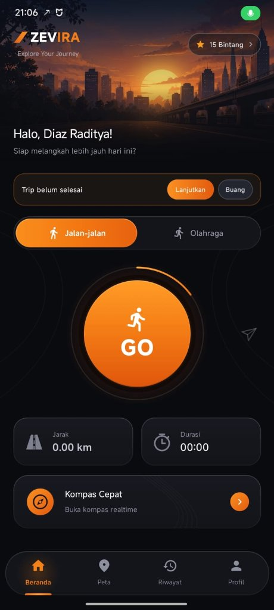
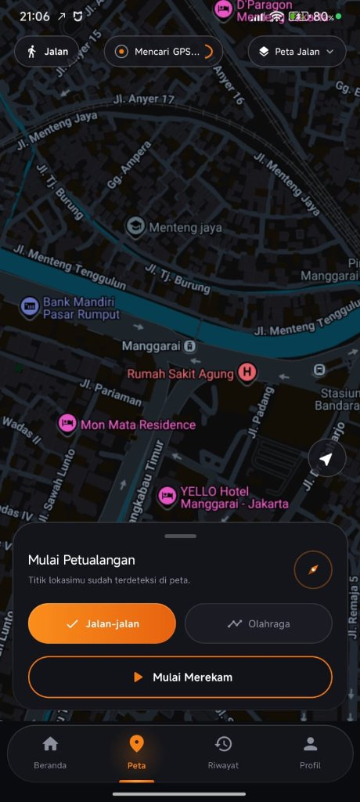
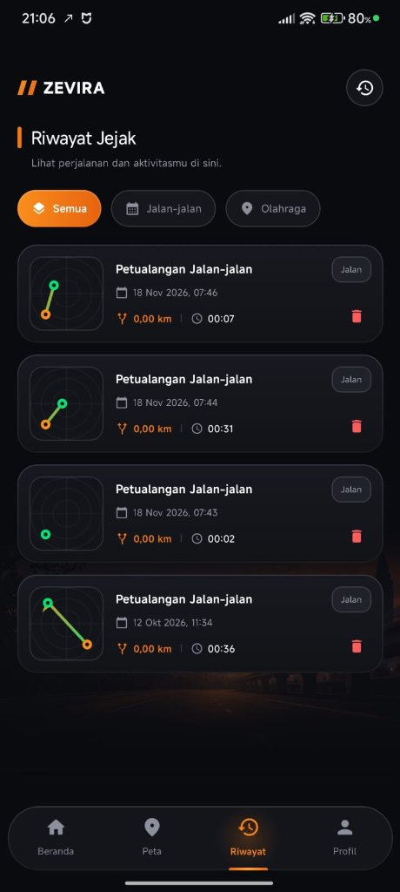
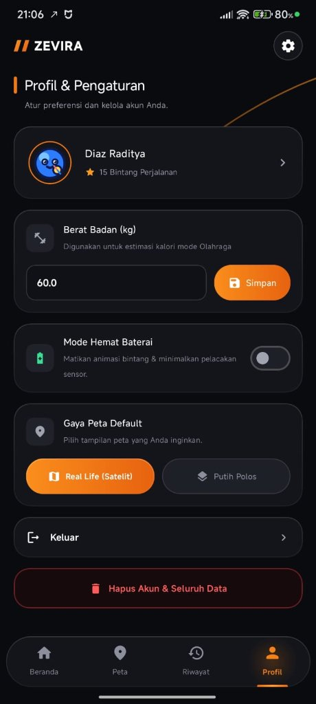

# Zevira — Modern Travel & Real-Time Activity Tracker for Android

[-3DDC84?style=for-the-badge&logo=android&logoColor=white)](https://developer.android.com)
[](https://kotlinlang.org)
[](https://developer.android.com/jetpack/compose)
[]()
[](https://www.mysql.com)
[]()

**Zevira** adalah aplikasi pelacak perjalanan dan aktivitas fisik (*travel & outdoor activity tracker*) berbasis Android berkinerja tinggi yang dirancang dengan perpaduan visual modern bertema **Dark Obsidian & Sunset Amber**, dibangun menggunakan **Jetpack Compose** dan **Material 3**. 

Zevira memungkinkan pengguna merekam rute penjelajahan secara presisi menggunakan sensor GPS perangkat, memvisualisasikan jejak rute secara *real-time* di atas peta interaktif gelap, menghitung pembakaran kalori berbasis bobot tubuh, mengarahkan kembali ke titik awal saat tersesat dengan fitur *Return to Start*, serta menyimpan kenangan perjalanan secara aman di cloud.

---

## 📱 Tampilan Antarmuka (UI Showcase)

Tampilan antarmuka Zevira mengusung filosofi desain modern, clean, dan imersif dengan gradien senja (*sunset skyline*), aksen oranye menyala (*neon amber*), serta kontras obsidian pekat yang nyaman di mata dan hemat konsumsi daya pada layar OLED/AMOLED:

| 1. Beranda | 2. Peta & Pelacakan | 3. Riwayat Jejak | 4. Profil & Pengaturan |
| :---: | :---: | :---: | :---: |
|  |  |  |  |

---

## 📖 Penjelasan Fungsi Tiap Halaman

Berikut adalah rincian lengkap mengenai fungsi, peran sistem, serta fitur-fitur yang terdapat pada masing-masing halaman utama aplikasi:

### 1. 🏠 Halaman Beranda (Dashboard / Home)
Halaman utama yang menjadi pusat kendali penjelajah saat pertama kali membuka aplikasi. Berfungsi memberikan ringkasan status harian, navigasi cepat, dan tombol peluncuran sesi perjalanan.

- **Fungsi Utama:**
  - Menyambut pengguna secara personal berdasarkan akun yang sedang aktif.
  - Memilih mode perjalanan (*Jalan-jalan* vs *Olahraga*) sebelum memulai aktivitas.
  - Memulai pelacakan lokasi (*Live GPS Tracking*) melalui tombol hero interaktif.
  - Menampilkan metrik akumulatif harian (jarak tempuh dan durasi).
  - Menyediakan akses instan ke sensor kompas digital secara *real-time*.
  - Menampilkan notifikasi pemulihan (*recovery alert*) jika terdapat perjalanan sebelumnya yang belum sempat diselesaikan.

- **Elemen UI & Fitur Penting:**
  - **Sunset City Skyline Header**: Ilustrasi latar pemandangan kota modern saat matahari terbenam yang membaur mulus ke dalam kanvas gelap obsidian.
  - **Brand Lockup & Bintang Perjalanan**: Logo `/ ZEVIRA` dengan subjudul *"Explore Your Journey"*, disertai pil badge transparan `★ 15 Bintang` yang mencerminkan pencapaian kilometer perjalanan pengguna.
  - **Sapaan Personal**: Menyapa nama pengguna secara dinamis (contoh: *"Halo, Diaz Raditya!"*) disertai pesan motivasi harian.
  - **Banner Pemulihan Trip**: Banner interaktif bertema gelap bila ada sesi perjalanan yang terhenti mendadak (pilihan *Lanjutkan* atau *Buang*).
  - **Mode Selector Segmented Pill**: Pemilih mode bertema pil kapsul modern dengan highlight oranye aktif untuk beralih antara mode *Jalan-jalan* dan *Olahraga*.
  - **Tombol Hero "GO"**: Tombol lingkaran oranye glossy dengan ikon pelari, aksen busur orbital kuadran atas, dan animasi efek sentuh responsif.
  - **Kartu Statistik Cepat**: Dua kartu bersudut membulat berisi metrik *Jarak (0.00 km)* dengan ikon jalan raya perspektif dan *Durasi (00:00)* dengan ikon stopwatch outline.
  - **Kartu Kompas Cepat**: Tombol pintas berhiaskan dial kompas oranye untuk langsung membuka sensor kompas navigasi.

---

### 2. 🗺️ Halaman Peta & Pelacakan Real-time (Live Map & Tracking)
Halaman peta interaktif layar penuh yang menyajikan pemantauan posisi geografis, penggambaran rute aktif secara dinamis, serta kendali perekaman aktivitas luar ruangan.

- **Fungsi Utama:**
  - Menampilkan lokasi aktual pengguna secara presisi dengan *fused location provider*.
  - Menggambar garis rute perjalanan (*live route polyline*) secara kontinu saat pelacakan berlangsung tanpa lag.
  - Memberikan indikator kesiapan sinyal sensor GPS perangkat secara transparan.
  - Memungkinkan pengguna beralih gaya peta antara *Peta Jalan (Dark Mode)* dan *Satelit Hybrid*.
  - Mengaktifkan fitur navigasi balik ke titik awal (*Return to Start*) agar penjelajah tidak tersesat.
  - Memulai, menjeda (*pause*), melanjutkan (*resume*), dan menghentikan (*stop*) rekaman perjalanan.

- **Elemen UI & Fitur Penting:**
  - **Peta Interaktif Dark Mode**: Peta vektor berbasis Leaflet lokal dengan filter malam kontras tinggi, menampilkan jalan, sungai, gedung, dan POI penting.
  - **Pulsing Blue User Marker**: Titik biru menyala berpusat putih dengan lingkaran halo transparan yang merepresentasikan koordinat dan akurasi GPS pengguna.
  - **3 Floating Top Control Pills**:
    - `[ 🚶 Jalan / 🏃 Olahraga ]`: Menampilkan mode pelacakan aktif.
    - `[ 🎯 Mencari GPS... ) ]`: Indikator konektivitas sensor satelit GPS dilengkapi lengkungan oranye neon.
    - `[ 🗂️ Peta Jalan ˅ ]`: Pengalih cepat tampilan peta jalan gelap atau citra satelit fotorealistis.
  - **Tombol Pusatkan Peta (Recenter)**: Tombol lingkaran mengambang berikon panah navigasi miring untuk mengunci kembali tampilan kamera peta ke posisi pengguna.
  - **Floating Action Card "Mulai Petualangan"**:
    - Kartu panel bawah yang elegan dengan drag handle putih.
    - Judul *"Mulai Petualangan"* & teks informatif status kesiapan lokasi.
    - Tombol shortcut kompas berjarum oranye di pojok kanan atas kartu.
    - Opsi tombol `Jalan-jalan` dan `Olahraga`.
    - Tombol aksi utama `[ ▶ Mulai Merekam ]` berbingkai oranye neon tebal.
  - **Live Tracking HUD**: Saat perekaman dimulai, kartu beralih menjadi panel metrik lengkap (kecepatan $km/j$, jarak akumulatif, durasi detik, dan tombol kontrol jeda/berhenti).

---

### 3. 📜 Halaman Riwayat Jejak (Trip History)
Halaman arsip personal yang menyimpan seluruh rekam jejak perjalanan dan aktivitas fisik yang telah diselesaikan oleh pengguna.

- **Fungsi Utama:**
  - Menyimpan dan menyortir seluruh riwayat trip pengguna secara kronologis (*offline-first* dengan SQLite/Room Database).
  - Menyaring daftar riwayat berdasarkan kategori aktivitas (*Semua*, *Jalan-jalan*, atau *Olahraga*).
  - Menampilkan ringkasan metrik setiap trip (nama petualangan, tanggal, jam keberangkatan, jarak tempuh kilometer, dan durasi).
  - Menampilkan pratinjau bentuk rute secara instan melalui thumbnail vektor.
  - Membuka halaman detail perjalanan untuk memutar ulang (*replay*) rute dan mengekspor berkas GPX.
  - Menyediakan fitur penghapusan catatan trip tertentu dengan dialog konfirmasi aman.

- **Elemen UI & Fitur Penting:**
  - **Brand Header Logo & Ikon Jam**: Logo ganda `// ZEVIRA` di kiri atas dan tombol riwayat lingkaran di kanan atas.
  - **Aksen Judul Oranye**: Garis penanda vertikal oranye `|` tebal di samping teks *"Riwayat Jejak"*.
  - **Kapsul Filter Interaktif**: Tiga filter chip kapsul (`Semua` bergradien oranye, `Jalan-jalan`, dan `Olahraga`).
  - **Thumbnail Radar Kartografi**: Wadah grafis bersudut membulat dengan kisi melingkar bertema radar; menampilkan titik hijau menyala bila trip berjarak pendek/statis, atau garis vektor kurva oranye-hijau dengan pin titik awal dan akhir bila rute memiliki pergerakan nyata.
  - **Informasi Kartu Terstruktur**: Judul trip jelas, baris kalender tanggal dan jam, serta ikon rute oranye dengan jarak `0,00 km` yang dipisahkan garis vertikal dari durasi waktu.
  - **Tag Kategori & Ikon Hapus**: Label kapsul aktivitas (`Jalan` / `Olahraga`) di sudut kanan atas kartu dan ikon tempat sampah merah (*Coral Red*) di sudut kanan bawah.
  - **Sunset Skyline Silhouette**: Siluet pemandangan senja di bagian dasar layar yang mempercantik akhir daftar riwayat.

---

### 4. 👤 Halaman Profil & Pengaturan (Profile & Settings)
Halaman manajemen akun, personalisasi preferensi aplikasi, dan konfigurasi performa perangkat keras.

- **Fungsi Utama:**
  - Menampilkan identitas akun yang sedang masuk (*Member Zevira*, *Pengguna Tamu*, atau *Akun Demo*).
  - Menampilkan akumulasi total Bintang Perjalanan yang berhasil dikoleksi dari setiap kilometer perjalanan.
  - Mengatur berat badan pengguna ($kg$) sebagai acuan matematis formula MET (*Metabolic Equivalent of Task*) dalam mengkalkulasi kalori yang terbakar secara presisi pada mode olahraga.
  - Mengaktifkan atau menonaktifkan *Mode Hemat Baterai* untuk memperpanjang daya tahan baterai ponsel saat pelacakan jarak jauh.
  - Menentukan gaya peta default yang otomatis dimuat setiap kali aplikasi dibuka (*Real Life Satelit* vs *Putih Polos*).
  - Menyediakan mekanisme keluar akun (*logout*) yang aman dengan penghapusan sesi lokal.
  - Menyediakan tindakan pembersihan permanen data dan akun pengguna (*GDPR / Privacy compliance*).

- **Elemen UI & Fitur Penting:**
  - **Header Brand & Tombol Pengaturan**: Logo `// ZEVIRA` berdampingan dengan tombol bulat ikon roda gigi (`⚙`).
  - **Kartu Identitas Pengguna**: Kartu permukaan gelap dengan avatar maskot Jejak di dalam bingkai lingkaran oranye menyala, nama pengguna, jumlah bintang, dan tanda panah navigasi.
  - **Kartu Berat Badan (kg)**: Dilengkapi ikon timbangan dalam squircle, input field angka modern berborder halus, dan tombol simpan kapsul oranye `[ 💾 Simpan ]`.
  - **Kartu Mode Hemat Baterai**: Dilengkapi ikon baterai ramah lingkungan dan tombol saklar (*switch toggle*) bertema oranye aktif.
  - **Kartu Gaya Peta Default**: Pilihan seleksi ganda antara `[ 🗺 Real Life (Satelit) ]` bergradien oranye menyala dan `[ 🗂 Putih Polos ]` bergaya minimalis.
  - **Kartu Keluar (Logout)**: Tombol aksi berikon pintu keluar untuk mengakhiri sesi dengan dialog konfirmasi.
  - **Kartu Hapus Akun & Data**: Kartu berbingkai merah pekat (*crimson red outline*) dengan ikon tempat sampah merah untuk menghapus akun dan seluruh database secara permanen.

---

### 5. 🧭 Floating Dock Bottom Navigation Bar
Bilah navigasi mengambang (*floating dock*) di bagian bawah layar yang menghubungkan keempat halaman utama aplikasi secara mulus:
- **Desain Kapsul Melayang**: Sudut membulat $32dp$ dengan latar `#14151A` dan garis batas tipis yang melayang anggun di atas latar belakang layar.
- **4 Tab Utama**: `Beranda` (Home), `Peta` (Location Pin), `Riwayat` (History Clock), dan `Profil` (Person).
- **Indikator Aktif Oranye**: Tab yang aktif mendapatkan pendaran cahaya (*radial glow*), warna oranye terang `#F58216`, serta garis indikator oranye di dasar kapsul dock.

---

## Arsitektur Sistem

Zevira menerapkan prinsip **Clean Architecture** dan pola desain **MVVM (Model-View-ViewModel)** dengan *Unidirectional Data Flow (UDF)*:

```
┌─────────────────────────────────────────────────────────────┐
│                      UI / Presentation                      │
│   Jetpack Compose · Material 3 · StateFlow · Custom Canvas   │
└──────────────────────────────┬──────────────────────────────┘
                               │ Observes UI State
┌──────────────────────────────▼──────────────────────────────┐
│                         ViewModels                          │
│     State Management · Coroutine Scope · Hilt Injection      │
└──────────────┬───────────────────────────────┬──────────────┘
               │                               │
┌──────────────▼──────────────┐ ┌──────────────▼──────────────┐
│      Location & Sensor      │ │       Repository Layer      │
│  · Foreground Service       │ │  · Data Synchronization     │
│  · FusedLocationProvider    │ │  · Network Request Handling │
│  · Kalman Filter + RDP      │ │  · Offline-First Strategy   │
│  · Sensor Fusion (Compass)  │ │                             │
└──────────────┬──────────────┘ └──────────────┬──────────────┘
               │                               │
┌──────────────▼───────────────────────────────▼──────────────┐
│                    Persistence & Network                    │
│   · Room ORM (SQLite) · Preferences DataStore · MySQL API   │
└─────────────────────────────────────────────────────────────┘
```

---

## Fitur Teknis Lanjutan

### 1. Mesin Pelacak GPS Presisi Tinggi (Strava-Grade Engine)
- **Multi-Mode Tracking**: Mode *Jalan Santai* (interval adaptif hemat daya) dan mode *Olahraga/Lari* (interval tinggi 1.5 detik dengan kalkulasi pace dinamis).
- **Kalman Filtering & Ramer-Douglas-Peucker (RDP)**: Menghilangkan noise sinyal GPS, lompatan titik koordinat liar (*jitter/teleport*), dan mereduksi ukuran polyline rute tanpa mengurangi bentuk aslinya.
- **Kalkulasi Kalori Real-Time Berbasis Bobot Tubuh**: Estimasi pembakaran kalori dihitung secara proporsional sesuai berat badan ($kg$) yang diatur pada profil pengguna dengan formula standar MET (*Metabolic Equivalent of Task*).
- **Proteksi Sensor GPS Fisik**: Sistem mendeteksi ketersediaan sensor GPS perangkat. Pelacakan dicegah bila sensor lokasi perangkat belum aktif, disertai dialog pengalihan ke pengaturan sistem Android.
- **Background Foreground Service**: Dilengkapi notifikasi persisten (*sticky notification*) dengan kontrol jeda dan penghentian perjalanan tanpa terganggu oleh mekanisme *battery saver* sistem operasi.

### 2. Mesin Peta Interaktif & Live Polyline
- **Offline Leaflet Bundle**: Menggunakan Leaflet 1.9.4 yang dibundle secara lokal di dalam aset aplikasi tanpa ketergantungan CDN eksternal.
- **Dual Map Layer**:
  - *Peta Jalan (Dark Mode)*: Tampilan kontras tinggi bergaya malam yang hemat daya.
  - *Citra Satelit*: Tampilan fotorealistis medan geografis untuk eksplorasi alam.
- **Live Polyline Drawing**: Garis rute perjalanan bergradien oranye digambar langsung di peta seiring pergerakan pengguna secara *real-time*.

### 3. Navigasi "Pulang ke Titik Awal" (Return to Start)
- Penunjuk arah vektor garis lurus (*azimuth*) dari posisi aktual kembali ke titik keberangkatan.
- Kalkulasi jarak garis lurus dan estimasi waktu tempuh berjalan kaki.
- Penyorotan rute awal di peta untuk memudahkan navigasi saat sinyal internet terbatas.

### 4. Sensor Kompas Orientasi Real-Time
- Menggunakan sensor fusi `TYPE_ROTATION_VECTOR` dengan *fallback* akselerometer dan magnetometer.
- *Low-pass filter* pada 30 FPS untuk pergerakan jarum kompas yang stabil dan responsif.
- Koreksi deklinasi magnetik (*true north calculation*) dan indikator kalibrasi sensor.

### 5. Riwayat, Timeline Log, dan Ekspor GPX
- Kartu riwayat perjalanan dengan thumbnail rute berbasis Compose Canvas yang sangat ringan dalam penggunaan memori.
- Timeline rute interaktif dengan log titik koordinat dan kecepatan.
- Ekspor berkas standar GPX 1.1 melalui Android `FileProvider` untuk diimpor ke Strava, Garmin Connect, atau Google Earth.

---

## Backend MySQL & Sinkronisasi Cloud

Zevira menyertakan layanan backend lengkap di direktori `server/` untuk mendukung integrasi multi-pengguna dan penyimpanan terpusat:

- **Teknologi**: Node.js, Express, MySQL 8.0, JSON Web Token (JWT), Bcrypt.
- **Endpoint API**:
  - `POST /api/auth/register` — Pendaftaran akun pengguna baru.
  - `POST /api/auth/login` — Autentikasi pengguna dan penerbitan token akses.
  - `POST /api/trips/sync` — Sinkronisasi perjalanan beserta titik koordinat GPS secara *batch*.
  - `GET /api/trips` — Mengambil riwayat perjalanan pengguna dari server.
  - `GET /api/leaderboard` — Papan peringkat jarak tempuh dan kalori antar-pengguna.

Panduan konfigurasi dan instalasi backend dapat dilihat pada [server/README.md](server/README.md).

---

## Teknologi yang Digunakan

| Kategori | Teknologi |
| :--- | :--- |
| **Bahasa Pemrograman** | Kotlin 2.0.0 |
| **UI Toolkit** | Jetpack Compose, Material Design 3, Accompanist |
| **Dependency Injection** | Dagger Hilt 2.51.1 |
| **Database Lokal** | Room Database (SQLite), AndroidX DataStore Preferences |
| **Asynchronous & Reactive** | Kotlin Coroutines, StateFlow, SharedFlow |
| **Location & Maps** | Google Play Services Location (Fused), Leaflet.js (Offline Bundle) |
| **Arsitektur** | Clean Architecture, MVVM, Repository Pattern |
| **Peralatan Build** | Gradle 8.10.2 (Kotlin DSL), Android Gradle Plugin 8.7.0 |
| **Target Lingkungan** | Min SDK 26 (Android 8.0), Target/Compile SDK 35 (Android 15) |

---

## Panduan Instalasi dan Menjalankan Proyek

### Prasyarat
1. **Java Development Kit (JDK)**: Versi 17 (disarankan Eclipse Temurin atau OpenJDK 17).
2. **Android SDK**: Build Tools 35.0.0.
3. **Android Studio**: Ladybug (2024.2.1) atau versi lebih baru.
4. Perangkat fisik Android dengan fitur *Developer Options* dan *USB Debugging* aktif.

### Langkah Build

1. **Kloning Repositori**:
   ```bash
   git clone https://github.com/projectmyhost/ZeviraApps.git
   cd ZeviraApps
   ```

2. **Kompilasi APK Debug**:
   ```bash
   ./gradlew assembleDebug
   ```
   Berkas APK akan dihasilkan pada:  
   `app/build/outputs/apk/debug/app-debug.apk`

3. **Menjalankan Pengujian Unit**:
   ```bash
   ./gradlew testDebugUnitTest
   ```

4. **Instalasi ke Perangkat Terhubung**:
   ```bash
   ./gradlew installDebug
   ```

5. **Kompilasi Bundle Rilis (AAB)**:
   ```bash
   ./gradlew bundleRelease
   ```
   Berkas Android App Bundle siap distribusi berada di:  
   `app/build/outputs/bundle/release/app-release.aab`

---

## Struktur Direktori

```
Zevira/
├── app/
│   ├── src/main/
│   │   ├── java/com/zevira/app/
│   │   │   ├── data/
│   │   │   │   ├── export/          # Konverter format GPX 1.1
│   │   │   │   ├── local/           # Room Database, DAO, Entity, DataStore
│   │   │   │   ├── location/        # TrackingService, KalmanFilter, Distance Calculator
│   │   │   │   └── sensor/          # Sensor Kompas dan Rotasi Vektor
│   │   │   ├── di/                  # Modul Dagger Hilt (DatabaseModule, ServiceModule)
│   │   │   ├── ui/
│   │   │   │   ├── components/      # Komponen UI kustom (Mascot, Card, CanvasThumbnail)
│   │   │   │   ├── navigation/      # NavHost, BottomBar, Rute Navigasi
│   │   │   │   ├── screens/         # Dashboard, Tracking, Compass, History, Detail, Auth, Profile
│   │   │   │   └── theme/           # Color, Typography, Shape, ZeviraTheme
│   │   │   └── ZeviraApp.kt         # Application class dengan inisialisasi Hilt & Timber
│   │   ├── assets/map/              # Leaflet.js, Leaflet CSS, map.html (Dark Map Styling)
│   │   └── res/                     # Asset grafis (bg_beranda_sunset), warna, ikon vektor, strings
│   └── build.gradle.kts
├── server/                          # REST API Server (Node.js & MySQL)
│   ├── schema.sql                   # Skema basis data terpusat
│   ├── server.js                    # Logika API autentikasi dan sinkronisasi perjalanan
│   └── package.json
├── docs/                            # Dokumentasi teknis & kebijakan privasi
│   ├── screenshots/                 # Tangkapan layar antarmuka aplikasi Zevira
│   │   ├── 01_beranda.jpg           # Tampilan layar Beranda (Home)
│   │   ├── 02_peta.jpg              # Tampilan layar Peta (Live Map)
│   │   ├── 03_riwayat.jpg           # Tampilan layar Riwayat Jejak (History)
│   │   └── 04_profil.jpg            # Tampilan layar Profil & Pengaturan (Profile)
│   ├── PLAY_STORE_CHECKLIST.md
│   ├── PRIVACY_POLICY.md
│   └── TERMS.md
├── build.gradle.kts
└── README.md
```

---

## Hak Cipta & Lisensi

Hak Cipta (c) 2024-2026 Zevira Project. Hak cipta dilindungi undang-undang.  
Kode sumber ini disediakan untuk tujuan peninjauan teknis dan portofolio pengembangan. Dilarang mendistribusikan ulang atau menggunakan bagian dari perangkat lunak ini secara komersial tanpa persetujuan tertulis dari pemilik hak cipta.
